<div align="center">

# Qash — Kotlin Multiplatform Expense Tracker

**A production cross-platform personal finance app built with Kotlin Multiplatform & Compose Multiplatform, shipped on Google Play and the App Store.**

[](https://kotlinlang.org)
[](https://www.jetbrains.com/lp/compose-multiplatform/)
[](https://play.google.com/store/apps/details?id=com.lihan.moneymanager)
[](https://apps.apple.com/us/app/moneymanager-expensetracker/id6503697767)
[](#architecture--modularization)
[](bitrise.yml)

<br/>

[-0D96F6?style=for-the-badge&logo=apple&logoColor=white)](https://apps.apple.com/us/app/moneymanager-expensetracker/id6503697767)
&nbsp;
[-34A853?style=for-the-badge&logo=googleplay&logoColor=white)](https://play.google.com/store/apps/details?id=com.lihan.moneymanager)

</div>

---

## Overview

**Qash** (`MoneyManagerKMP`) is an offline-first expense tracking application sharing UI, presentation, domain, and data layers across **Android** and **iOS** via **Kotlin Multiplatform (KMP)** and **Compose Multiplatform**.

Built with a focus on real-world production engineering, the project demonstrates:
- **15-module Clean Architecture** with strict layer boundaries and custom Gradle convention plugins (`build-logic`).
- **Unidirectional Data Flow (MVI)** across all screens with immutable state, sealed actions, and one-shot UI events.
- **Zero-data-loss database migration** from Realm Kotlin to **Room KMP** with bundled SQLite.
- **Custom Design System (`MoneyTheme`)** supporting Light/Dark modes and 3 locales (English, Traditional Chinese, Japanese).
- **Automated unit testing** (`commonTest`) and **Bitrise CI/CD** pipelines for PR validation and release distribution.

---

## Screenshots

> Shared **Compose Multiplatform** UI running natively on both **Android** (Pixel 10 Pro) and **iOS** (iPhone 18 Pro), with full Light & Dark theme support.

### Android — Light Mode

| Home & Budget Ring | Category Breakdown | Trend Analytics | Quick Add & Keypad |
| :---: | :---: | :---: | :---: |
| 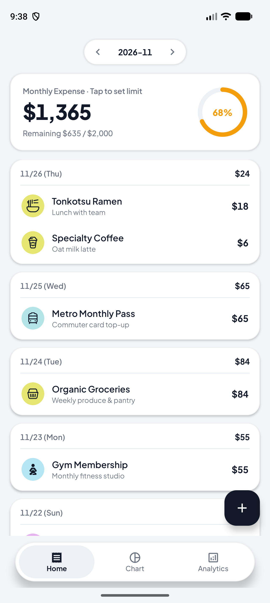 | 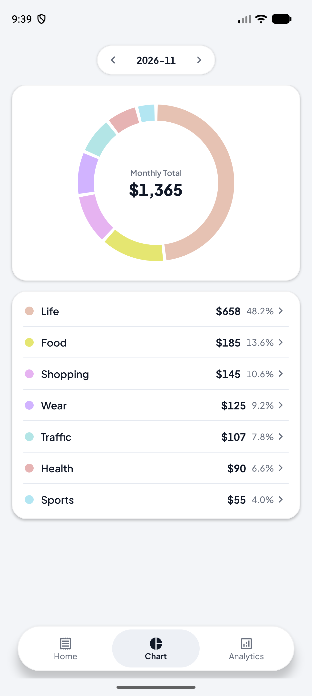 | 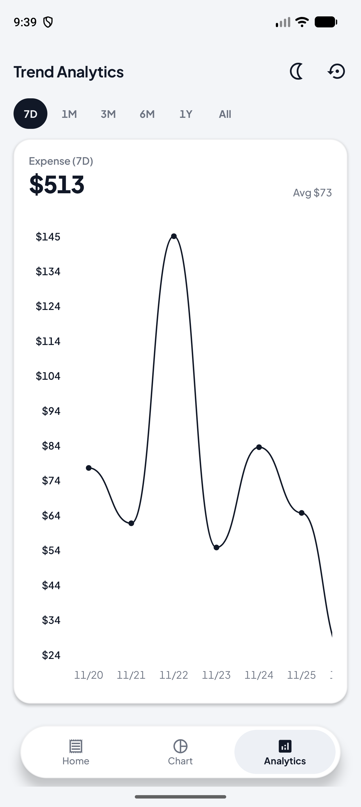 | 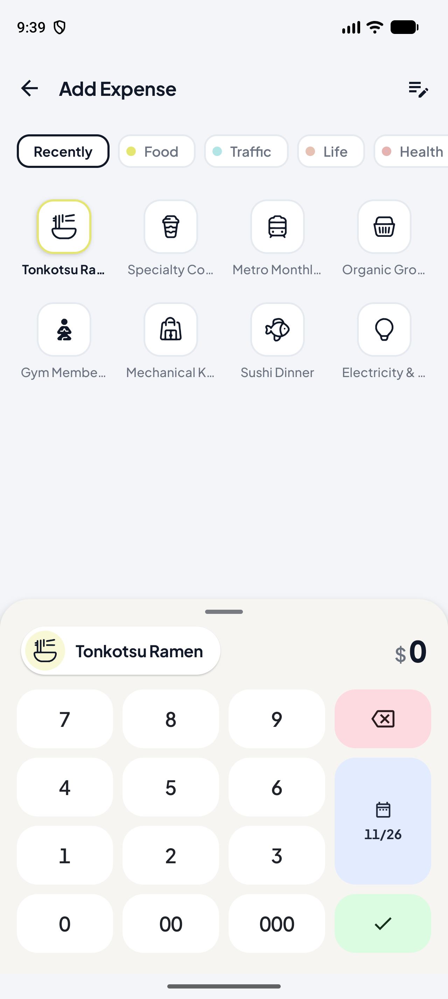 |

### Android — Dark Mode

| Home & Budget Ring | Category Breakdown | Trend Analytics | Quick Add & Keypad |
| :---: | :---: | :---: | :---: |
| 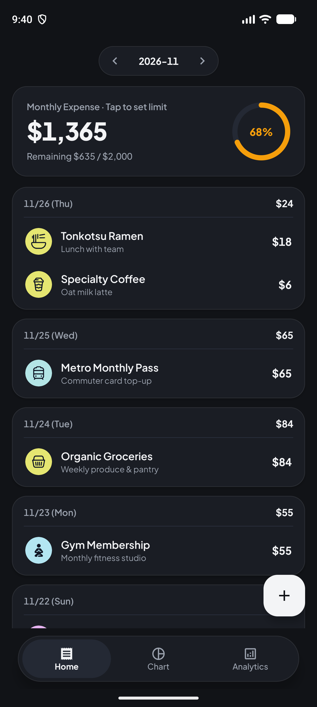 | 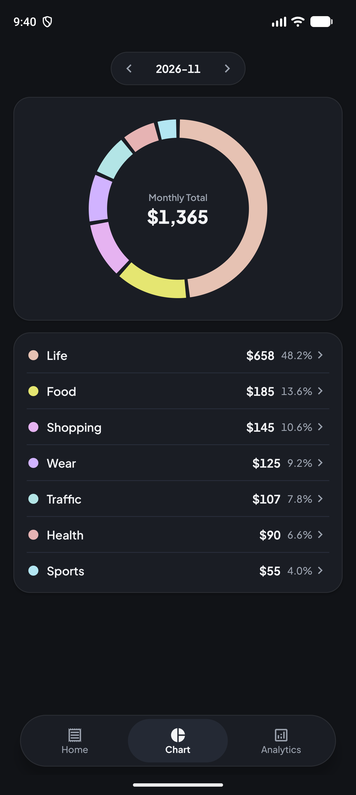 | 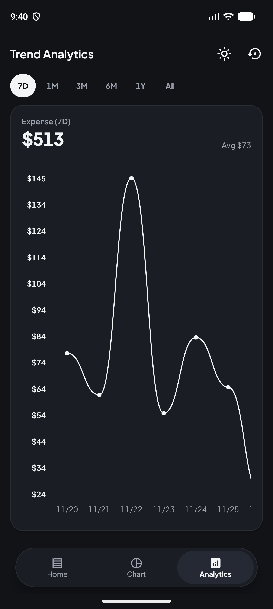 | 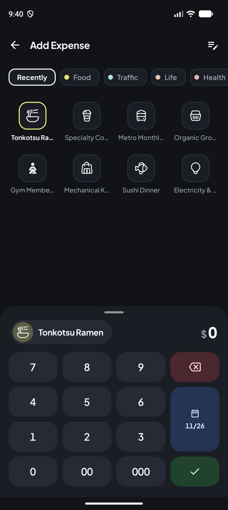 |

### iOS — Light Mode

| Home & Budget Ring | Category Breakdown | Trend Analytics | Quick Add |
| :---: | :---: | :---: | :---: |
| 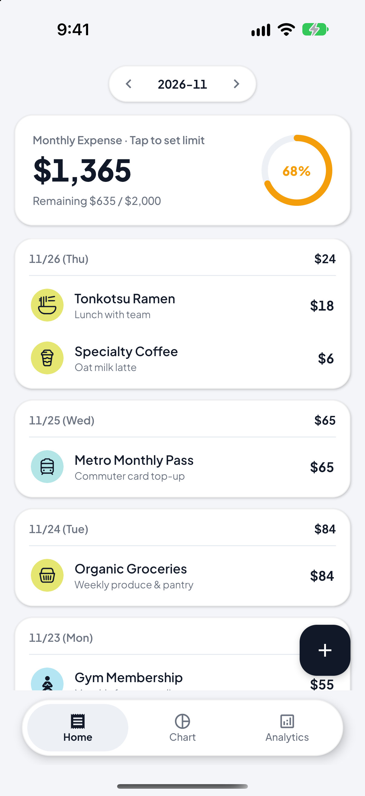 | 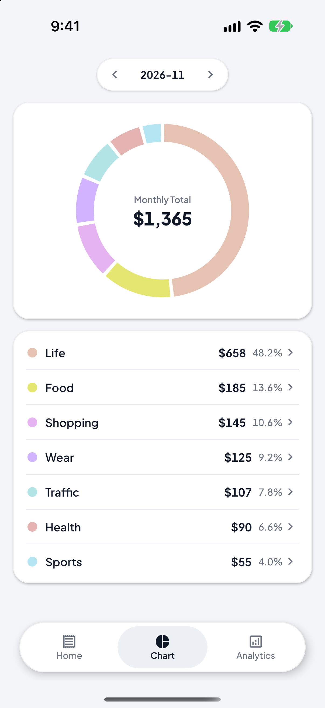 | 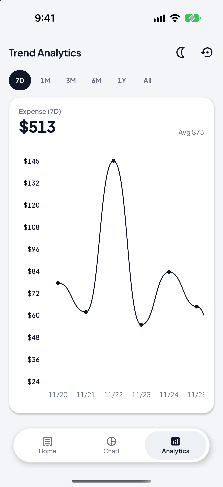 | 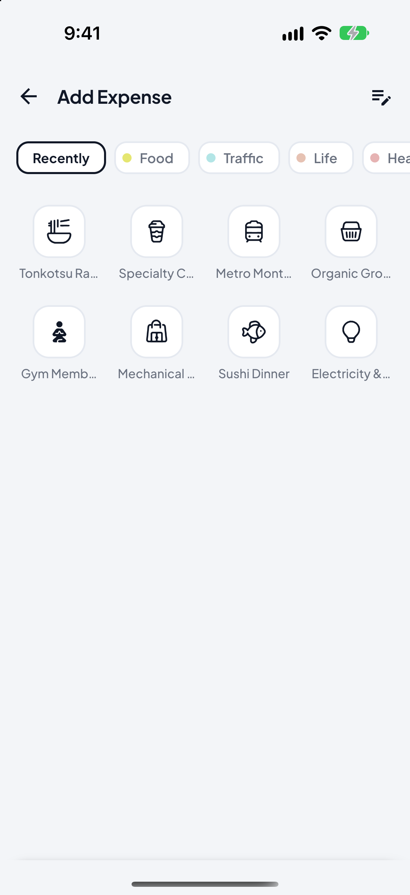 |

### iOS — Dark Mode

| Home & Budget Ring | Category Breakdown | Trend Analytics | Quick Add |
| :---: | :---: | :---: | :---: |
| 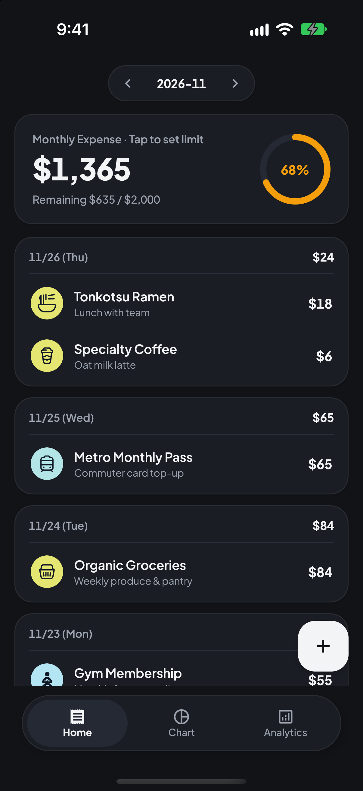 | 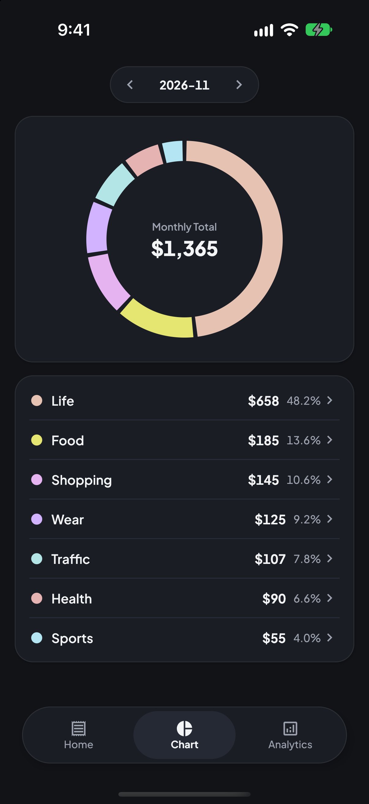 | 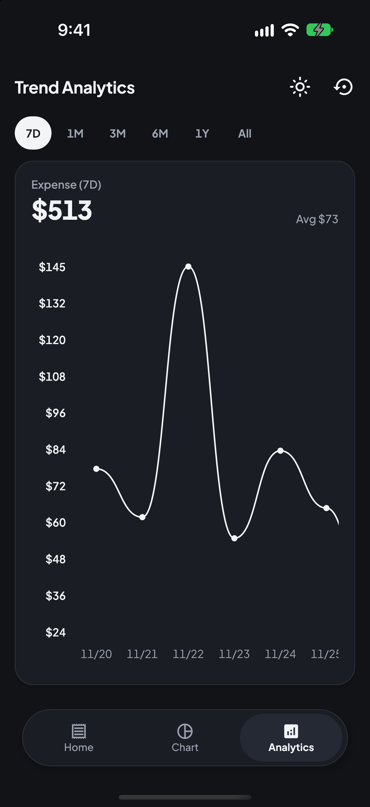 | 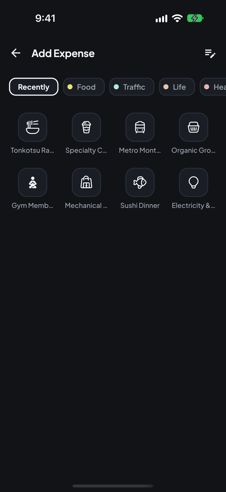 |

---

## Key Features

- **Monthly Budget & Spending Ring**: Set monthly spending limits with customizable warning thresholds and real-time remaining budget tracking.
- **Fast Expense Entry**: Built-in numeric keypad, date picker, and "Recently Used" category shortcuts for one-handed logging.
- **Flexible Category Management**: Create, edit, color-code, hide/show, and drag-and-drop reorder expense types and subcategories.
- **Visual Breakdown & Drill-Down**: Interactive donut chart grouping monthly spending by category with percentage shares and transaction drill-down.
- **Multi-Range Trend Analytics**: Line chart visualizing spending trends and daily averages across `7D`, `1M`, `3M`, `6M`, `1Y`, and `All` timeframes.
- **Local Backup & Restore**: Export and import expense records offline using native file pickers (`FileKit`) and CSV/JSON serialization.
- **Theming & Localization**: Instant in-app Light/Dark theme switching and full localization in **English**, **繁體中文**, and **日本語**.

---

## Architecture & Modularization

The codebase follows **Clean Architecture** combined with **Feature-Sliced Modularization** (`15` Gradle modules) and Gradle's `TYPESAFE_PROJECT_ACCESSORS`.

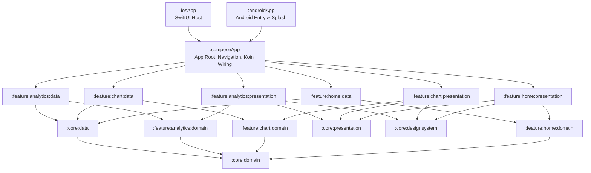

### Module Breakdown

| Module | Responsibility |
| --- | --- |
| `:androidApp` | Android `Application`, `MainActivity`, Splash Screen, and Android-specific wiring |
| `iosApp` | Thin SwiftUI wrapper hosting `MainViewController` from `:composeApp` |
| `:composeApp` | Shared Compose entry point, root navigation graph, and Koin DI assembly (`initKoin`) |
| `:core:domain` | Pure Kotlin domain models, repository interfaces, and formatting/date utilities (zero UI/Android deps) |
| `:core:data` | Room KMP database (`MoneyManagerDatabase`), DAOs, entities, mappers, `MultiplatformSettings`, and Realm→Room migrator |
| `:core:designsystem` | `MoneyTheme` tokens, `Plus Jakarta Sans` typography, vector icons, shared components, and Compose Multiplatform resources |
| `:core:presentation` | Shared presentation utilities (`UiText`, platform helpers, reusable UI patterns) |
| `:feature:home:{domain,data,presentation}` | Monthly expense feed, spending limit progress & warnings, add/edit expense keypad, drag-to-reorder category editor |
| `:feature:chart:{domain,data,presentation}` | Monthly category donut chart and per-category transaction detail view |
| `:feature:analytics:{domain,data,presentation}` | Multi-range trend line chart, theme toggle, and offline CSV/JSON backup & restore |
| `build-logic` | 8 custom Gradle convention plugins standardizing KMP, CMP, Feature, Room, and BuildKonfig setup |

---

## Engineering Highlights

### 1. MVI Unidirectional Data Flow
Every screen separates state management from rendering via a **Root / Screen composable split**:
- `ViewModel` exposes a single immutable `StateFlow<State>`, handles `onAction(Action)`, and emits one-shot side effects (`UiEvent`) over a `Channel`.
- Stateless `Screen` composables accept `State` and `(Action) -> Unit`, keeping UI previews clean and ViewModel logic 100% unit-testable in `commonTest`.

### 2. Zero-Data-Loss Realm → Room KMP Migration
Originally built on Realm Kotlin, Qash was migrated to **Room KMP** (`androidx.room` + `androidx.sqlite:sqlite-bundled`) for long-term KMP stability and SQL performance:
- Implemented an automated, idempotent `RealmToRoomMigrator` that detects legacy Realm data on startup and migrates expenses, types, categories, and spending limits into Room without disrupting existing App Store / Google Play users.
- Versioned exported Room schemas under `core/data/schemas/`.

### 3. Build Scalability with Convention Plugins
All 15 modules share a single Version Catalog (`gradle/libs.versions.toml`) and 8 convention plugins in `build-logic/`:
- `convention.kmp.library`, `convention.cmp.library`, `convention.cmp.feature`, `convention.cmp.application`
- `convention.android.application`, `convention.android.application.compose`, `convention.room`, `convention.buildkonfig`

### 4. Multiplatform Testing & CI/CD
- **Unit Tests**: **17 `commonTest` test suites (53 tests)** across `:core:domain`, `:core:data`, and all three `:feature` modules covering ViewModels, repositories, mappers, and date/number formatters using `kotlin.test` and `kotlinx-coroutines-test` with in-memory fakes.
- **Bitrise CI/CD** (`bitrise.yml`):
  - `ci_test_and_build` (on Pull Requests): Runs all KMP & Android unit tests (`testAndroidHostTest testDebugUnitTest`) and builds the Debug APK on JDK 21.
  - `deploy_android` (on `master` / `main`): Runs the full test suite, builds & signs the Release AAB, and supports automated deployment to Firebase App Distribution and Google Play Internal Track.

---

## Tech Stack

| Category | Technologies |
| --- | --- |
| **Language & Multiplatform** | Kotlin `2.0.10`, Kotlin Multiplatform (Android + iOS), Coroutines & Flow |
| **UI & Design System** | Compose Multiplatform `1.7.0`, Material 3, Custom `MoneyTheme`, Custom Compose `Canvas` Charts, `colorpicker-compose` |
| **Architecture & Navigation** | Clean Architecture, MVI, Type-Safe Navigation Compose (`navigation-compose`) |
| **Dependency Injection** | Koin (`koin-core`, `koin-compose`, `koin-compose-viewmodel`) |
| **Local Persistence** | Room KMP (`2.7.0-alpha11`), Bundled SQLite (`sqlite-bundled`), `multiplatform-settings` |
| **Data & Files** | `kotlinx.serialization`, `kotlinx-datetime`, `FileKit`, `de.halfbit:csv` |
| **Build & CI/CD** | Gradle Convention Plugins (`build-logic`), Version Catalogs, KSP, BuildKonfig, Bitrise |
| **Testing** | `kotlin.test`, `kotlinx-coroutines-test`, Fake Repositories in `commonTest` |

---

## Getting Started

### Prerequisites
- **JDK 21** (required by Gradle & AGP)
- **Android Studio** (Ladybug or newer) for Android & KMP development
- **Xcode** (macOS) to build and run the iOS app

### Build & Run

```bash
# 1. Clone the repository
git clone https://github.com/encorex32268/MoneyManagerKMP.git
cd MoneyManagerKMP

# 2. Run all KMP host unit tests
./gradlew testAndroidHostTest --console=plain

# 3. Build Android Debug APK
./gradlew :androidApp:assembleDebug

# 4. Install & run on a connected Android device/emulator
./gradlew :androidApp:installDebug
```

> **iOS**: Open `iosApp/iosApp.xcodeproj` in Xcode, select a simulator or device, and run.
>
> **Configuration**: No API keys are required to build locally — `BuildKonfig` safely defaults to empty strings if `local.properties` has no custom keys.

---

## License

This project is developed and maintained by [Li-Han](https://github.com/encorex32268) as a production cross-platform mobile application and engineering portfolio project.
